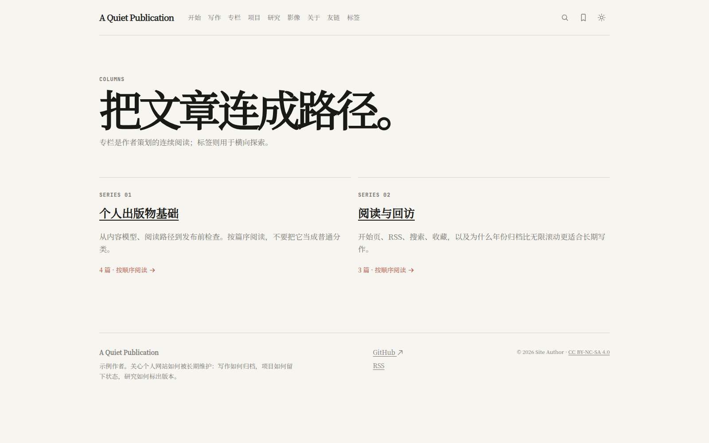
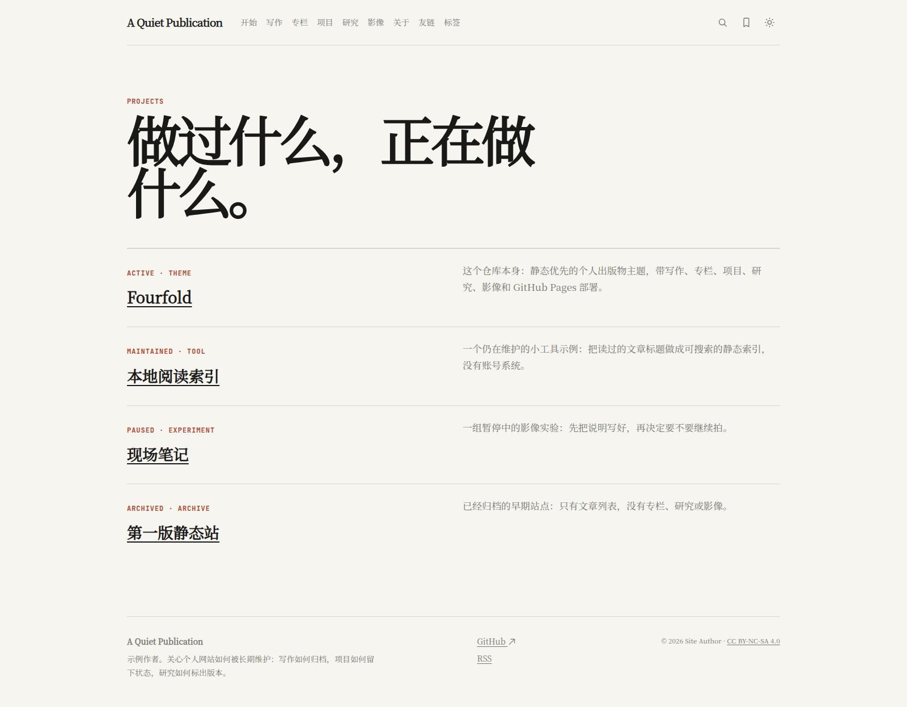
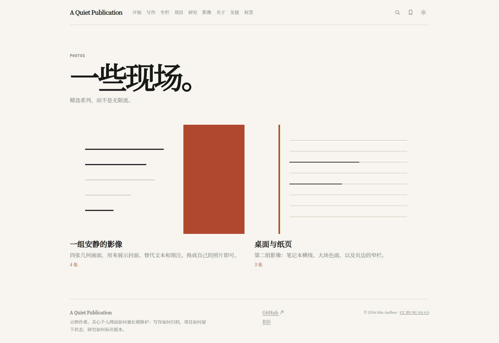
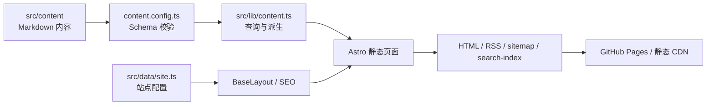

# Fourfold

> 一个静态优先、内容优先的个人出版物主题。
>
> A static-first personal publication theme for Astro.

**在线演示 / Live demo：** <https://liyuk.github.io/astro-fourfold/>

Fourfold 把个人站点从“文章列表”收成一套可以长期维护的出版物：写作是档案，专栏和标签负责发现，项目、研究与影像放在同一套静态站点里。搜索、收藏、RSS 和明暗主题都不需要后端。仓库里的作者、文章和图片都是示例，替换后即可当作自己的起点。

Writing, columns, tags, projects, research notes, and photo essays share one static archive. Search, favorites, RSS, and the light/dark theme run without a backend. Sample content is fictional. The rest of this README is the adoption guide in Chinese.

## 核心能力

- **写作档案**：Markdown 文章、年月 URL、年份归档、精选、最近更新、分页、上一篇 / 下一篇。
- **长文体验**：自动目录、摘要、阅读时长、标签、相关文章、复制链接、本地收藏。
- **专栏**：按推荐顺序组织连续阅读，不把专栏当成普通分类。
- **标签**：由文章 frontmatter 派生索引和聚合页。
- **项目**：`active`、`maintained`、`paused`、`archived` 四种状态，以及可选的演示地址和仓库地址。
- **研究**：类型、版本号，以及可选的论文和代码链接。
- **影像**：封面、短文、带替代文本和图注的画廊。
- **友链**：按分组排列的外部站点。
- **开始页**：按读者的问题提供入口。
- **搜索**：构建期生成 `/search-index.json`，页面匹配标题、摘要、正文和标签，并把查询同步到 `?q=`。
- **收藏**：`localStorage` 保存文章 URL，不需要账号，不上传数据。
- **主题**：CSS 变量切换明暗，并尊重系统主题。
- **发布基础设施**：RSS、sitemap、动态 robots、canonical、Open Graph、文章 `BlogPosting` JSON-LD、404。
- **内容校验**：`npm run validate:content` 检查必填字段、重复 `translationKey`、重复文章 URL、无效专栏和本地图片引用。
- **GitHub Pages**：用 `SITE_URL` 和 `BASE_PATH` 支持项目子路径。仓库自带 Actions 工作流。

评论、邮件订阅、云端收藏、统计和 CMS 保持为外部接入，不绑定供应商。内容文件是 Markdown。若要 MDX，再自行加入官方的 `@astrojs/mdx` 集成。

## 你会看到什么

截图来自本地生产构建，使用与在线演示相同的 `SITE_URL=https://liyuk.github.io` 和 `BASE_PATH=/astro-fourfold`。

### 首页

首页同时放站名、精选、最近更新，以及项目和研究的入口。


### 文章

文章页包含摘要、日期、标签、收藏、复制链接和由标题生成的目录。


### 搜索

搜索页支持标题、摘要、标签和正文匹配，地址栏保留 `?q=`。


### 专栏、项目与影像







## 快速开始

```bash
npm install
npm run dev
```

打开 <http://localhost:4321>。本地开发默认走站点根路径，不需要先配置域名。

生产构建：

```bash
npm run validate:content
npm run check
npm run build
npm run preview
```

`npm run build` 会先做内容校验和 `astro check`。与在线演示一致的构建命令是：

```bash
SITE_URL=https://liyuk.github.io BASE_PATH=/astro-fourfold npm run build
```

## 配置

地址由两个环境变量决定，在 `astro.config.mjs` 和 `src/data/site.ts` 里读取。

| 变量 | 作用 | 不要写成 |
| --- | --- | --- |
| `SITE_URL` | 站点源站，用于 sitemap、canonical、RSS、Open Graph、JSON-LD | 不要带仓库子路径 |
| `BASE_PATH` | 站点挂在域名下的路径。根路径用 `/` | 不要写完整 URL |

`src/data/site.ts` 会把二者拼成对外地址。子路径如果同时出现在两个变量里，canonical 和 sitemap 会被拼两次。

复制 `.env.example` 为 `.env` 后按部署方式修改。三种常见情况：

### GitHub Pages 项目站点

在线演示就是这种。仓库名 `astro-fourfold`，页面在用户域名的子路径下：

```env
SITE_URL=https://liyuk.github.io
BASE_PATH=/astro-fourfold
```

结果是 <https://liyuk.github.io/astro-fourfold/>。换成自己的仓库时，只改用户名和仓库名，不要把用户名写进主题源码。

仓库里的 [`.github/workflows/deploy-pages.yml`](.github/workflows/deploy-pages.yml) 会按 GitHub 上下文自动写成：

```text
SITE_URL=https://实际用户名.github.io
BASE_PATH=/实际仓库名
```

这适用于 **项目站点**。部署前在仓库 Settings → Pages → Build and deployment 中选择 **GitHub Actions**，推送到 `main` 后工作流会发布 `dist/`。

### GitHub Pages 用户站点或组织站点

仓库名为 `用户名.github.io`，站点在域名根上，而不是在仓库名子路径上。上面的工作流会把 `BASE_PATH` 设成仓库名，因此需要改工作流里的环境变量：

```env
SITE_URL=https://用户名.github.io
BASE_PATH=/
```

### 自定义域名

自定义域名通常也从根路径提供站点。在 GitHub Pages 或托管商处绑定域名，并把构建环境改为：

```env
SITE_URL=https://你的域名
BASE_PATH=/
```

其他静态托管（Cloudflare Pages、Netlify、Vercel、对象存储）同样只需要在构建环境里提供这两个变量，然后发布 `dist/`。

### 站点身份

读者看到的名字不在环境变量里，而在 `src/data/site.ts`：

- `name`、`title`、`description`
- `author.name`、`author.bio`、`author.email`
- `social` 链接
- `license`：页脚里的**内容**许可，不是仓库的软件许可证
- `writingPageSize`、`tagIndexThreshold`
- `features`：搜索、收藏、主题、RSS、复制链接等开关

导航文案和顺序在 `src/data/navigation.ts`。界面字符串在 `src/data/i18n.ts`。当前默认语言是 `zh-cn`，schema 里预留了 `en` 和 `translationKey`，但还没有独立的英文路由。

## 内容作者指南

所有公开内容都在 `src/content/`。frontmatter 不符合 `src/content.config.ts` 时，构建会失败。`draft: true` 可以提交，但不会进入列表、分页、RSS、sitemap 或搜索。

示例里各有一篇写作草稿、一个项目草稿和一条友链草稿，用来对照这个行为。发布自己的站点前删掉全部示例。

```text
src/content/
├── writing/      写作
├── columns/      专栏
├── projects/     项目
├── research/     研究
├── photos/       影像
└── links/        友链
```

### 写作

```yaml
---
title: "文章标题"
description: "列表、SEO 和 RSS 使用的摘要"
locale: zh-cn
translationKey: optional-stable-id
publishedAt: 2026-08-20
updatedAt: 2026-08-22
author: "作者"
tags: [主题一, 主题二]
featured: true
minutes: 8
column: "专栏名称"
columnOrder: 1
draft: false
---
```

- `publishedAt` 决定地址：`/writing/YYYY/MM/文件名/`。
- 列表按 `updatedAt ?? publishedAt` 倒序。更新文章不会把旧地址搬走。
- `featured: true` 进入首页精选。精选和“最近更新”是两份名单。
- `minutes` 显示在文章页。目录来自二、三级标题。
- 相关文章来自共同标签。上一篇 / 下一篇按时间，不按专栏篇序。
- 同一 `locale` 下的 `translationKey` 不能重复。
- 写作索引按 `writingPageSize` 分页，年份页从文章日期自动生成。

正文用 Markdown。代码块会用浅色 / 深色两套 Shiki 主题。

### 专栏

专栏是一条阅读路径，不是分类。一篇文章最多通过 `column` 关联一个专栏，并用 `columnOrder` 表示篇序。`column` 必须等于专栏文件的 `title`。

```yaml
---
title: "专栏名称"
description: "这条路径解决什么问题，以及建议如何阅读。"
locale: zh-cn
slug: column-slug
order: 1
draft: false
---
```

地址是 `/columns/slug/`。专栏页按篇序列出文章。标签仍然负责横向查找。

### 标签

标签没有单独的内容文件。写作 frontmatter 里的 `tags` 会生成 `/tags/` 和 `/tags/某个标签/`。出现次数低于 `tagIndexThreshold` 的标签不会进入总索引。

项目和研究也可以写 `tags`。详情页会链到写作标签页，因此这些词需要至少在一篇公开文章里出现，否则链接没有目的地。两个标签如果去掉空格和大小写后相同，校验会失败。

### 项目

```yaml
---
title: "项目名称"
description: "一句话说明它是什么、现在处于什么阶段。"
locale: zh-cn
publishedAt: 2026-08-20
status: active          # active | maintained | paused | archived
type: theme
tags: [Astro, 发布]
externalUrl: https://example.com/
repositoryUrl: https://github.com/example/project
featured: false
draft: false
---
```

地址是 `/projects/YYYY/MM/文件名/`。有 `externalUrl` 时显示“访问项目”，有 `repositoryUrl` 时显示“源代码”。两个都可以不写。示例覆盖了四种状态。

### 研究

```yaml
---
title: "笔记标题"
description: "这则笔记现在主张什么。"
locale: zh-cn
publishedAt: 2026-08-20
kind: note              # 自由文本，例如 note、preprint
version: "0.3"
tags: [架构]
paperUrl: https://example.com/paper
codeUrl: https://github.com/example/project
draft: false
---
```

地址是 `/research/YYYY/MM/文件名/`。`version` 会显示在标题上方。`paperUrl` 和 `codeUrl` 可选，页面上分别标成“论文”和“代码”。示例里的论文链接指向公开文档，只为了让字段可见，发表自己的笔记时请替换。

### 影像

```yaml
---
title: "一组影像"
description: "这组图在说什么。"
locale: zh-cn
slug: essay-slug
order: 1
cover: /photos/cover.svg
photos:
  - src: /photos/cover.svg
    alt: "画面里实际有什么"
    caption: "可选图注"
draft: false
---
```

地址是 `/photos/slug/`。Markdown 正文会显示在画廊上方，适合写成短文。`cover` 用于索引。以 `/` 开头的 `src` 和 `cover` 必须放在 `public/` 下，校验脚本会检查文件是否存在。每张图都要有 `alt`。

### 友链

```yaml
---
title: "站点名称"
description: "为什么把它留在这里。"
locale: zh-cn
url: https://example.com/
group: 文档
order: 1
draft: false
---
```

`url` 必须是 `http` 或 `https`。同一 `group` 会排在一起，分组顺序跟条目的 `order` 走。友链页只展示这些字段，不渲染正文。

## 架构速览



目录、图标系统和运行时边界见 [`PROJECT.md`](PROJECT.md)。面向 Astro 主题站的英文介绍见 [`docs/BRANDING.md`](docs/BRANDING.md) 和 [`docs/ASTRO-THEME-SUBMISSION.md`](docs/ASTRO-THEME-SUBMISSION.md)。

```text
src/
├── components/       壳层、文章、目录、收藏、复制链接、图标
├── content/          Markdown 内容集合
├── data/             站点配置、导航、界面文案
├── layouts/          BaseLayout
├── lib/              内容查询、URL、收藏、主题
├── pages/            页面、RSS、搜索索引
└── styles/           token、全局样式、正文样式
```

界面图标集中在 `src/components/chrome/Icon.astro`：`24 × 24` viewBox、统一线宽、`currentColor`，只有 `sm / md / lg` 三种尺寸。

## 部署

1. 改 `src/data/site.ts`，以及构建环境里的 `SITE_URL` 和 `BASE_PATH`。
2. 换掉 `public/og-default.svg` 和全部示例内容。
3. 确认草稿、外链和图片 `alt`。
4. 运行 `npm run check && npm run build`。
5. 在真实域名上检查首页、一篇文章、RSS、sitemap、canonical 和 404。

GitHub Pages 项目站点推送到 `main` 即可，前提是 Pages 使用 GitHub Actions。用户站点和自定义域名要先改工作流中的两个环境变量，见上面的配置一节。

页面路径：

```text
/                    首页
/start/              开始
/writing/            写作
/writing/page/2/     写作分页
/writing/2026/       年份归档
/columns/            专栏
/projects/           项目
/research/           研究
/photos/             影像
/about/              关于
/links/              友链
/tags/               标签
/search/             搜索
/favorites/          收藏
/rss.xml             RSS
```

## 公开发布入口

- 在线演示：<https://liyuk.github.io/astro-fourfold/>
- GitHub 仓库：<https://github.com/Liyuk/astro-fourfold>
- GitHub Release：<https://github.com/Liyuk/astro-fourfold/releases/tag/v0.1.0>
- GitHub Discussions 介绍帖：<https://github.com/Liyuk/astro-fourfold/discussions/1>
- Astro Showcase 提交评论：<https://github.com/withastro/roadmap/discussions/521#discussioncomment-18099696>
- Astro Theme Portal：<https://portal.astro.build/>

仓库目前**没有** `LICENSE` 文件。页脚里的 CC 协议只是 `src/data/site.ts` 的内容许可占位，可以改成你自己的内容协议；它不是这个仓库的软件许可证。公开发布衍生作品之前，需要另选并加入软件许可证。

## 设计取舍

- 编辑化而非营销化：用标题、摘要、日期和分隔线建立秩序。
- 单列优先：长文宽度受控，列表可扫描。
- 内容优先：图片是一种内容类型，不是首页装饰。
- 精选与最近分离：一个负责策展，一个表示还在更新。
- 专栏与标签分工：一个负责线性阅读，一个负责横向探索。
- 少量客户端 JS：静态 HTML 仍可读，交互只在搜索、主题、收藏和复制链接上。

Fourfold 指写作、项目、研究与个人表达这四个互相支撑的面。站名、颜色、字体、文案和导航都可以换成你自己的。
